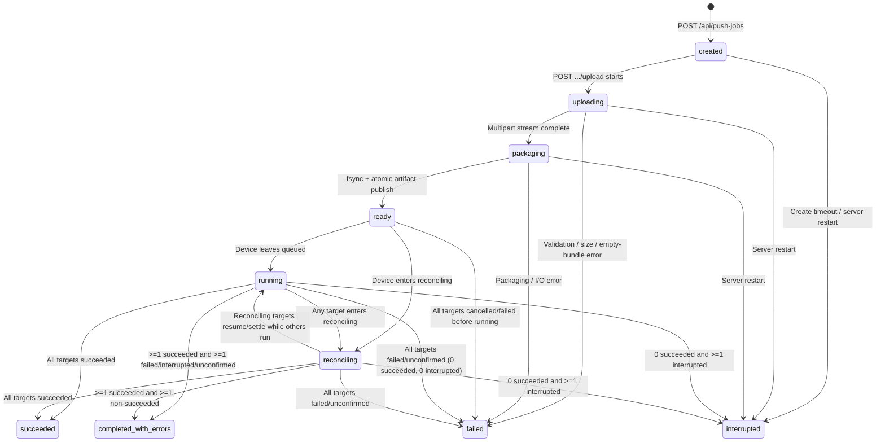

# Durable Push / Sync Jobs

**Push Files** and **Sync Folder** run as server-owned, SQLite-backed jobs with immutable artifacts, resumable HTTP Range transfers, per-device execution ownership, and explicit operator recovery controls. APK installation remains on its separate install pipeline.

---

## Scope and Deployment Requirements

- **Supported target**: PICO 4 Ultra Enterprise registered with a canonical lowercase `styly_device_id_v1` GUID (`8-4-4-4-12` hex), advertising `capabilities: ["push_job_id_v1", "push_resume_v1"]` and `push_state.status == "available"`.
- **Same-version requirement**: Push/Sync runs only between matching server and client versions, regardless of artifact size. There is no non-resumable or identity-less Push fallback. Devices on older APKs or legacy serial IDs can only receive APK installation and client self-update commands.
- **Coordinated cutover**: Deploy the server and matching client APK together when no Push/Sync transfer is in flight. Unscoped artifact URLs from older builds are rejected. Finish pending serial-ID Push/Sync jobs before upgrading; old serial-keyed rows remain as historical records and are not migrated to GUIDs (create a new job for the registered GUID if delivery is still needed).
- **Removed legacy endpoints**: `POST /api/bundles` returns `410 Gone` and `/bundles/` is unmounted. External scripts must use `POST /api/push-jobs` → `POST /api/push-jobs/{job_id}/upload` → Admin WebSocket `PUSH_FILES {job_id}`. Historical files under `DATA_DIR/bundles/` are untouched and can be backed up and removed manually once no longer needed.

---

## Ownership Model and Safety Invariants

### Three Independent Ownership Mechanisms

Push/Sync separates device execution, network concurrency, and post-timeout safety into three distinct mechanisms:

| Mechanism | Owner & Storage | Scope / Key | Acquired When | Released When |
|---|---|---|---|---|
| **1. Client Execution Ownership** | Android `PushJobCoordinator` (`files/push-jobs/state.json` → `state.active`) | 1 active or interrupted job per device | Persisted before `PUSH_JOB_ACCEPTED` | Atomically moved to `pendingResults` on terminal completion, cleared by exact `PUSH_RESUME_REJECTED`, or expired via `resume_expired` |
| **2. Global Transfer Slot & HTTP Lease** | Server `TransferRegistry` + `PushTransferLeases` (in-memory) | `TransferKey("push", device_id, job_id, attempt=1)` bounded by `MDM_MAX_CONCURRENT_TRANSFERS` | Scheduler claims `waiting_transfer -> dispatching` and mints random `?lease=<token>` | `PUSH_PHASE validating`, settled terminal result, exact `validating`/`applying` registration after offline download completion, 60s HTTP no-write watchdog, or pending `CANCEL_PUSH_JOB` |
| **3. Persistent Device Fence** | Server SQLite (`push_device_fences` table) | `device_id` → exact `{job_id, attempt, artifact_id}` or `unknown-active-job` | Reconciliation deadline expires (`reconciling -> unconfirmed`) | Matching late `PUSH_FILES_RESULT`, matching `PUSH_RECONCILE_REPORT` (`status: "absent"`), eligible `downloading` interruption revival (`unconfirmed -> queued`), or proven client process replacement when no cancellation is pending (`process_instance_id` change, or a new job-v1 process reporting `active: null` against a legacy/no-PID fence) |

### Transactional and Concurrency Invariants

1. **Persist before side effects (Client)**: `PushJobCoordinator` is owned by `MdmClientApplication` and serializes all operations on a single actor. It never sends `PUSH_JOB_ACCEPTED` before saving `state.active`, never mutates destination files before awaiting the durable `beforeApply` (`applying`) checkpoint, and never sends `PUSH_FILES_RESULT` before atomically clearing `state.active` and writing the terminal outbox entry. If durable state cannot be loaded or saved, the MDM client stays alive, advertises `push_state.status = "unavailable"` with empty Push capabilities, and rejects new work with `client_persistence_unavailable`.
2. **Single-worker transactions before network I/O (Server)**: `PushJobStore` owns the single serialized SQLite worker; `PushJobManager` executes compound policies (queue claims, disconnect settlement, `settle_result`, fence updates) in one transaction and builds exact-revision snapshots *before* commit. Transfer release, admin snapshot publication, and `PUSH_RESULT_ACK` happen only *after* commit. If a transaction fails, no side effect is emitted and the client retains its outbox entry for replay.
3. **Per-device session serialization**: Device `REGISTER` replacement, disconnect settlement, incoming job-v1 device frames, and final `EXECUTE_PUSH_FILES` session checks + bounded `send_str` serialize under `_device_lock(device_id)`. One scheduler dispatch task runs per device (including slot waits); superseded sockets cannot settle phases, ACKs, or results. If a disconnect DB commit fails, a per-device recovery task is flushed under the same lock before any replacement `REGISTER` exposes a new session.
4. **Decoupled admin backpressure**: Committed snapshots are coalesced per `job_id` and sent by an independent background publisher where each admin WebSocket send is bounded by `MDM_ADMIN_SEND_TIMEOUT` (5s). Stalled admin sockets are closed (and auto-recover via a fresh `PUSH_JOBS_SNAPSHOT` on reconnect) without ever holding a device lock. Fence creation or clearance revises every affected non-terminal job snapshot plus the terminal blocking job.

---

## Canonical Lifecycle and State Machines

### Job State Machine



- Every canonical mutation increments the job's monotonic 64-bit `revision`.
- Upload/packaging failures or `created` expiry settle both the job and any never-dispatched `queued` device rows in a single transaction.

### Device Assignment State Machine

Assignments use fixed `attempt = 1` per `(job_id, device_id)`; operator **Retry failed devices** creates a new job linked via `retry_of_job_id`.

| State | Terminal? | Meaning | Allowed Next States |
|---|:---:|---|---|
| `queued` | No | Waiting for queue turn, job gate, or per-device manual `Resume` | `waiting_transfer`, `failed`, `interrupted` |
| `waiting_transfer` | No | Claimed by scheduler; waiting for a global transfer slot | `queued`, `dispatching`, `failed`, `interrupted` |
| `dispatching` | No | Slot + HTTP lease acquired; `EXECUTE_PUSH_FILES` sent; awaiting `PUSH_JOB_ACCEPTED` | `queued`, `downloading`, `validating`, `applying`, `reconciling`, `succeeded`, `failed`, `interrupted` |
| `downloading` | No | Accepted by client; HTTP Range transfer or local partial check in progress | `queued`, `validating`, `applying`, `reconciling`, `succeeded`, `failed`, `interrupted` |
| `validating` | No | Complete bytes on device; transfer slot released; SHA-256 + ZIP extraction running | `applying`, `reconciling`, `succeeded`, `failed`, `interrupted` |
| `applying` | No | Durable `beforeApply` checkpoint saved; mutating destination directory | `reconciling`, `succeeded`, `failed`, `interrupted` |
| `reconciling` | No | Management WebSocket lost or accept timeout elapsed; awaiting exact device evidence | `queued`, `downloading`, `validating`, `applying`, `succeeded`, `failed`, `interrupted`, `unconfirmed` |
| `succeeded` | **Yes** | Destination updated and `PUSH_FILES_RESULT(success)` committed | — |
| `failed` | **Yes** | Definitive failure or confirmed `cancelled` (`failure_code` recorded) | — |
| `interrupted` | **Yes** | Unrecovered pre-accept or state-loss interruption (settled; eligible for `Retry failed devices`, not `Cancel`) | — |
| `unconfirmed` | **Yes**\* | Reconciliation deadline expired without proof; installs a `push_device_fences` row | `queued`, `succeeded`, `failed`\* |

\* *`unconfirmed` is a terminal state (`TERMINAL_DEVICE_STATES`), with two fence-guarded exceptions in `PushJobManager`: ① an exact saved `downloading` interruption report revives the row to `queued` (manual wait) and clears the fence when the artifact is still `retained`, no Cancel/Retry/superseding work exists, and the matching fence holds; ② when `cancel_requested_at` is set, exact `absent` / `resume_not_authorized` evidence settles `failed` (`failure_code: "cancelled"`) and clears the fence, or an offline worker that finished before seeing cancel settles its actual `succeeded` / `failed` outcome. Without pending cancellation, a late result or `absent` report clears only the fence while preserving `unconfirmed` history.*

### Queue Ordering and Dispatch Permission

Device queues are strictly ordered by server-wide monotonic `enqueue_seq`: a newer enabled job never overtakes an older non-terminal assignment on the same device, even while the older job is still uploading or paused.

Whether `PushScheduler` may claim a `queued` row is governed by `dispatch_permission(queue_reason)` combined with the job-level gate `job.dispatch_enabled`:

| `DispatchPermission` | `queue_reason` Condition | Scheduler Behavior |
|---|---|---|
| `automatic` | `None` or an internal scheduler wait (`"awaiting_dispatch"`, `"same_device_job"`, `"dispatch_recovery"`) | Dispatched automatically while `job.dispatch_enabled == true` (held by the job gate while `job.dispatch_enabled == false`) |
| `operator_authorized` | `queue_reason == "resumable_replay"` (set by targeted `PUSH_FILES {job_id, target_devices}`) | Dispatched once even if `job.dispatch_enabled == false`; degrades to `"device_offline"` (`manual_resume_required`) if the device disconnects before acceptance |
| `manual_resume_required` | `queue_reason` in `{"download_interrupted", "client_restarted", "dispatch_paused", "device_offline"}` | Paused for this device until explicit targeted **Resume**; other eligible devices in the same job continue normally |

- `"dispatch_paused"` is persisted when server startup pauses active/waiting rows, when targeted **Resume** on a `ready` job pauses non-selected sibling targets, or when a target's Push state turns `unavailable` during slot wait / dispatch (`_pause_unavailable_dispatch`).
- Client interruption reasons `server_lease_revoked` and `storage_write_failed` map to server `queue_reason = "download_interrupted"`.
- Repeated interrupted reports while already `queued`, `waiting_transfer`, or `dispatching` are idempotent no-ops (they do not re-pause `"resumable_replay"` or drop a replacement slot). If a target's Push state becomes `unavailable` while waiting for a transfer slot or dispatching, the scheduler returns it to `queued` with `queue_reason = "dispatch_paused"` without failing or discarding retained partial bytes.
- Each dispatched assignment records an immutable per-device dispatch `revision` on first claim. Even as the aggregate job `revision` advances, `(job_id, attempt, artifact_id, dispatch_revision)` remains fixed across Resume authorizations for that assignment.

---

## Resumable Artifact Transfer

### Job Creation, Upload, and Initial Dispatch

1. **Create (`POST /api/push-jobs`)**:
   - Looks up `client_request_id` **before** live-target preflight so retrying a lost response after a target disconnects still returns the original job (`409 Conflict` if the canonical SHA-256 fingerprint over sorted targets, normalized `dest_path`, and `mode` differs).
   - Rejects targets that are offline, legacy/provisional, missing `push_job_id_v1` + `push_resume_v1`, or reporting `push_state.status != "available"`.
2. **Upload and Publish (`POST /api/push-jobs/{job_id}/upload`)**:
   - Streams multipart files into `DATA_DIR/push-work/{job_id}/`, stripping OS metadata segments case-insensitively (`.DS_Store`, `._*`, `Thumbs.db`, `desktop.ini`, `__MACOSX`, `.Spotlight-V100`, `$RECYCLE.BIN`, `.Trash-*`) and returning `skipped_count` (rejecting with `400` if 100% of uploaded entries were metadata).
   - Enforces the 2 GiB content limit on uploaded source bytes and extracted content (ZIP container overhead may make the archive slightly larger).
   - Packages the archive, `fsync`s the file (plus parent directory on POSIX; Windows uses file `fsync` + atomic `os.replace`), records exact byte size, SHA-256, and strong ETag `"<sha256>"` in SQLite `push_artifacts`, publishes `DATA_DIR/push-artifacts/{artifact_id}.zip`, and transitions the job to `ready`.
3. **Dispatch (`PUSH_FILES {job_id}`)**:
   - An untargeted `PUSH_FILES {job_id}` sets `dispatch_enabled = 1` on a `ready` job; repeating an untargeted `PUSH_FILES` on an already-dispatched job only acknowledges it without reopening manual waits.
   - Destination, `delete_extras` (`false` for Push Files, `true` for Sync Folder), target list, and artifact metadata are read exclusively from SQLite.

### Scoped Lease URL and HTTP Range Contract

When dispatching `(job_id, device_id, attempt=1)`, the server builds an absolute URL from the accepted WebSocket authority:
`http(s)://<server-host>:<port>/artifacts/{artifact_id}?lease=<random-token>` (the `lease` query value is redacted from HTTP access logs; canonical admin snapshots expose only `/artifacts/{artifact_id}`, which is not downloadable without an active lease). The server serves an artifact only while the physical file still matches its recorded byte size (`404` otherwise).

- **Client request headers**:
  - Fresh download (`offset == 0`): `GET` with `Accept-Encoding: identity`.
  - Resumed download (`0 < offset < artifact_size`): `GET` with `Range: bytes=<offset>-`, `If-Match: "<sha256>"`, and `Accept-Encoding: identity`.
- **Same-lease connection replacement**: If a client reconnects using the same live lease token while its earlier HTTP handler is still open, the server aborts and replaces that handler so the Range transfer continues under the same assignment and transfer slot.
- **Server and Client HTTP Disposition Matrix**:

| HTTP Response / Local Event | Server Condition | Client Action | Validated Partial (`artifact.part`) | Worker Outcome |
|---|---|---|---|---|
| `200 OK` | Full request, or unsupported bounded/suffix `Range` syntax ignored | Verify identity encoding + matching strong ETag; overwrite from byte `0` | Replaced from byte `0` | Continue download |
| `206 Partial Content` | Valid open-ended `Range: bytes=N-` with matching `If-Match` | Verify ETag, identity encoding, `Content-Length`, and `Content-Range: bytes N-M/T` (`M < T`); append at `N` | Appended | Continue download |
| `409 Conflict` + `X-Push-Lease-Status: revoked` | Missing, stale, server-restarted, watchdog-expired, or cancelled lease token | Do not retry HTTP; stop attempt | **Retained** | `Interrupted("server_lease_revoked")` → manual **Resume** |
| `404 Not Found` / `410 Gone` | Tombstoned/missing artifact or physical file size mismatch | Stop immediately | Retained by worker, then **deleted** once terminal failure is saved | `Completed(fail, "artifact_unavailable")` |
| `412 Precondition Failed` (or changed ETag / non-identity encoding) | Wildcard, weak, multiple, or mismatched `If-Match` validator | Reject untrusted artifact identity | **Deleted** | `Completed(fail, "artifact_identity_mismatch" / "download_failed")` |
| `416 Range Not Satisfiable` | `N >= artifact_size` (`Content-Range: bytes */T`) | Always rejected (complete partials skip HTTP locally) | **Retained** | `Interrupted("download_interrupted")` → manual **Resume** |
| `408` / `429` / `5xx` / truncated body / transient network `IOException` | Transient server or transport error | Retry with `1s, 2s, 4s, 8s` backoff while 60s byte-progress window remains (backoff resets once payload bytes arrive). On 60s window expiry: stop | **Retained** (if `> 0` bytes; `validated_offset = 0` if none yet) | `Interrupted("download_interrupted")` → manual **Resume** (even at `0` bytes) |
| Other unexpected `4xx` / invalid ETag or non-identity `Content-Encoding` before write | Unexpected HTTP status or invalid response headers | Stop immediately without network retry | **Retained** on resume (`offset > 0`); none at `offset == 0` | Fresh (`offset == 0`): `Completed(fail, "download_failed")` (unexpected HTTP status) or `Completed(fail, "artifact_identity_mismatch")` (missing/weak ETag or non-identity encoding)<br>Resume (`offset > 0`): `Interrupted("download_interrupted")` → manual **Resume** |
| Local disk write / `fsync` error | Device storage full or I/O error during download | Never retry network | **Retained** if prior validated bytes exist | With partial: `Interrupted("storage_write_failed")`<br>At `0` bytes: `Completed(fail, "storage_write_failed")` |

*(Note: `validated_offset` reported in registration/reconciliation is resume bookkeeping, not live console byte progress.)*

### Dual 60-Second Progress Timers

- **Client byte-receipt timer (60s monotonic)**: Resets *only* when artifact payload bytes are written locally (TCP connect and HTTP headers do not reset it). Cancels blocked OkHttp calls when expired. Management WebSocket disconnects do *not* stop a progressing HTTP download.
- **Server HTTP write-progress lease (60s)**: Renews *only* on successful HTTP response body writes (`MDM_TRANSFER_TIMEOUT=600s` applies only to APK installation; healthy Push transfers may run beyond 600s). While live, this lease defers `reconciling` deadline expiry and survives an acceptance-probe race if the device already began downloading. After 60s without writes, the watchdog revokes the token, aborts and awaits the exact HTTP handler, releases the transfer slot, and delegates the durable transition to dispatch recovery.

### Validation, Hashing, and Destination Apply

1. **Zero-HTTP local fast path**: If `metadata.json` matches the command and either `artifact.zip` or `artifact.part` already equals `artifact_size` (for example, all bytes reached disk just before a socket drop), the worker skips HTTP and enters validation directly. (An interrupted assignment still requires operator **Resume** authorization and acquires/releases a dispatch slot cleanly.)
2. **Slot release and SHA-256 (`validating`)**: Once all bytes are on disk, the worker queues `PUSH_PHASE validating` on the coordinator actor (immediately releasing the server's transfer slot and stopping the HTTP watchdog) while computing SHA-256 on the worker thread:
   - *Uninterrupted single-pass download*: incremental SHA-256 computed over buffers as written (no disk re-read).
   - *Resumed execution*: kept prefix bytes are **never** re-read during HTTP transfer (avoiding a 60s server lease stall); the complete file is hashed once during `validating`.
   - On match, `artifact.part` is atomically renamed to `artifact.zip` and `PUSH_TRANSFER_COMPLETE` is emitted. On mismatch, both `artifact.part` and `metadata.json` are deleted (`sha256_mismatch`).
3. **Extraction and `DOWNLOAD_COMPLETE`**: `PushFilesWorker` bounds ZIP entry count and expanded bytes, rejects path traversal, symlinks, and conflicting entries, extracts into `staging/`, and emits `DOWNLOAD_COMPLETE` (`task: "push"`, `job_id`, `attempt`, `artifact_id`, `dest_path`, `delete_extras`).
4. **Destination check and `beforeApply` (`applying`)**: Validates canonical shared-storage destination (must be a subdirectory under `/storage/emulated/0`, never root or protected top-level directories `Android`, `Download`/`Downloads`, `DCIM`, `Pictures`, `Movies`, `Music`, `Documents`, `Alarms`, `Notifications`, `Podcasts`, `Ringtones`, and never traversing destination symlinks). Awaits durable `applying` persistence (`beforeApply`) and emits `PUSH_PHASE applying`. (`applying` permits destination mutation; a worker interrupted before or during `beforeApply` never modifies destination files.)
5. **Apply and Settlement**: `BundleSync.apply` copies/overwrites files (and deletes extras + empty directories when `delete_extras == true`). Coordinator atomically clears `state.active`, records `pendingResults` + `completedReceipts` (capped at 256 entries / 7 days), deletes the `.push-tmp` attempt directory, and sends `PUSH_FILES_RESULT` until `PUSH_RESULT_ACK` accepts it or rejects it with `retryable: false` (an omitted `retryable` field is treated as retryable).

---

## Operator Controls and Console Mapping

### Offline and Reconnect Policy

**Offline devices never start queued work automatically by reconnecting.**

| Assignment State When Device Disconnects (or Turn Arrives Offline) | Server Settlement (`settle_offline_before_dispatch` / Disconnect) | Recovery Path |
|---|---|---|
| `queued` / `waiting_transfer` (never dispatched, `dispatch_enabled=1`) | Settled immediately to `failed` (`failure_code: "device_offline_before_dispatch"`) | **Retry failed devices** once back online |
| `queued` / `waiting_transfer` (previously dispatched) or `reconciling` with pending Resume | Returned to `queued` with `queue_reason: "device_offline"` (`manual_wait: true`) | Operator **Resume** (retains partial bytes) or **Cancel** |
| `dispatching` (unaccepted: `accepted_at IS NULL`) | Enters short `reconciling` (`MDM_PUSH_ACCEPT_RECONCILIATION_TIMEOUT = 60s`); disconnect withdraws automatic replay | Becomes `interrupted` if `absent` → **Retry failed devices** |
| `downloading` / `validating` / `applying` (accepted worker) | Enters `reconciling` (`MDM_PUSH_RECONCILIATION_TIMEOUT = 1800s`, deferred while HTTP lease writes progress); worker continues on device | Converges automatically on reconnect / `PUSH_FILES_RESULT`, or operator **Cancel** while offline |

*(Note: If a replacement `REGISTER` arrives before the old socket's disconnect callback, the server runs the same offline settlement under `_device_lock(device_id)` before adopting the new session.)*

### Operator Action Eligibility Matrix

Snapshot assignments include server-computed flags from `push_jobs.assignment_actions` (`manual_wait`, `resume_required`, `cancellable`, `retryable`), which the console combines with live connectivity and `push_state_status`:

| Action & Admin WS Message | Server Flag / Target Filter | Live Device Requirement | Exact Behavior |
|---|---|---|---|
| **Initial Dispatch**<br>`PUSH_FILES {job_id}` | Job is `ready` with `dispatch_enabled == false` (no `target_devices`) | Online targets execute; targets that went offline during upload fail with `device_offline_before_dispatch` | Opens `dispatch_enabled = 1` and wakes scheduler immediately. Repeating without `target_devices` after dispatch is a safe ACK no-op. |
| **Resume / Resume all**<br>`PUSH_FILES {job_id, target_devices}` | `resume_required == true` (job gate closed **or** row in `manual_wait`), no pending cancel, not superseded by Retry | **Must be online** with `push_state_status == "available"` and `push_job_id_v1` + `push_resume_v1` (**Resume all** skips ineligible rows) | Requires explicit non-empty `target_devices`. Authorizes only listed targets (other paused rows stay paused). Keeps original dispatch `revision` and 24h retention clock; mints a fresh HTTP lease token on dispatch. |
| **Cancel / Cancel all**<br>`CANCEL_PUSH_JOB {job_id, target_devices?}` | `cancellable == true`:<br>① Never-dispatched paused `queued` job-v1 row (`dispatch_revision IS NULL`, `resume_required == true`), **or**<br>② Dispatched job-v1 row (`dispatch_revision IS NOT NULL`, `resume_supported == true`) in `queued` with `manual_wait` (including after a client `interrupted` report), **offline** `reconciling`, or fenced `unconfirmed` (`blocking_fence == true`). *(Server terminal `interrupted` and online `reconciling`/active workers are not cancellable.)* | Online **or** offline (refused for `reconciling` while online so the device can report its outcome; gated behind confirmation UI) | **Case ① (never dispatched)**: Immediately settles on server as `failed` (`cancelled`) with no client message; terminalizes job if final target; leaves remaining `ready` targets paused.<br>**Case ② (dispatched)**: Persists `cancel_requested_at`, revokes any live HTTP lease, probes online device via `PUSH_RECONCILE_REQUEST`, and sends `PUSH_RESUME_REJECTED` when client `interrupted` state is reported. Settles `failed` (`cancelled`) upon exact `PUSH_RECONCILE_REPORT(status: "absent")` or synthetic `PUSH_FILES_RESULT(fail, "resume_not_authorized")` (or records actual `succeeded`/`failed` if an offline worker finished before seeing cancel), clearing any matching fence. Already-applied files are not rolled back; ownership/fences remain until confirmed. |
| **Retry failed devices**<br>`RETRY_FAILED_PUSH_JOB {job_id, client_request_id}` | `retryable == true`: `failed` (excluding `cancelled` and `artifact_missing`), `interrupted`, or `unconfirmed`; artifact still `retention_state == "retained"` on disk; not superseded by a newer dispatched/pending job for `(device_id, dest_path)` by `enqueue_seq` (including schema-1 dispatch evidence) | **Must be online** with `push_state_status == "available"` and Push capabilities (offline targets are skipped and stay retryable; fails if 0 eligible online targets) | Creates and dispatches a new job (`retry_of_job_id`) reusing the immutable `artifact_id` without re-upload. Preserves original success records and fences (`unconfirmed` devices wait for fence clearance before the retry job dispatches). Idempotent on `client_request_id` (replay returns existing retry job without changing dispatch/manual-wait state). |
| **Reconcile**<br>`RECONCILE_PUSH_DEVICE {device_id}` | Device has a row in `push_device_fences` (remains available even after Retry supersedes the old assignment) | Online with `push_state_status == "available"` | Sends `PUSH_RECONCILE_REQUEST` for the fenced identity. Never force-clears a fence without client/process evidence; send failures report an admin error without closing the admin socket. |

*(APK installation runs on a separate client worker and can overlap Push/Sync when a transfer slot is free; Reboot bypasses transfer slots.)*

### Web Console Rendering

- **`Devices` PROGRESS cell**: Renders directly from canonical `PUSH_JOBS_SNAPSHOT` / `PUSH_JOB_UPDATED` assignments via `pushTaskCellHtml()` without writing Push state into `deviceTaskState`:
  - Non-terminal: `Waiting…`, `Job pending · offline`, `Resume required` (with row **Resume** / **Cancel** buttons), `Transferring…`, `Validating…`, `Pushing…` / `Syncing…`, `Awaiting status confirmation` (`· offline` when disconnected), `Cancelling…`.
  - Terminal: `✓ pushed` / `✓ synced (+added ~updated -deleted)`, `✗ cancelled`, `✗ failed`, `Status unknown` (`unconfirmed`).
  - Latest APK Install / Integrity Verify status renders on a separate labeled second line alongside Push.
- **`Needs attention` tab**: Dynamically lists canonical Push items needing operator action (**Resume all**, **Cancel all**, **Retry failed devices**, **Reconcile**, or **Reboot** remediation for `Push state unavailable`), separate from provisional unresolved-identity connections. Pending cancellations disappear from `Needs attention` immediately while remaining visible in `Devices`.
- **`Activity log`**: Read-only historical job view.

---

## Restart, Retention, and Durable State Recovery

### Server Startup and Reconciliation

On server startup, before accepting traffic:

1. `uploading`, `packaging`, and expired `created` jobs transition to `interrupted`, settling never-dispatched `queued` targets and cleaning `push-work/`.
2. `waiting_transfer` returns to `queued`; `dispatching`, `downloading`, `validating`, and `applying` enter `reconciling` (for resumed dispatches, the current dispatch state and `accept_deadline` govern acceptance timeouts while preserving historical `accepted_at`).
3. `dispatch_enabled` is paused (`0`) on surviving jobs so no command auto-sends before operator **Resume** / **Resume all** (which also dispatches an uploaded `ready` job whose initial browser `PUSH_FILES` frame was lost).
4. All in-memory HTTP lease tokens are discarded. Any device still downloading hits `409` (`X-Push-Lease-Status: revoked`), keeps its partial, and reports `server_lease_revoked` (mapped to `download_interrupted`) for manual **Resume**.
5. Artifact retention references are rebuilt from durable rows (measured from the latest referencing terminal job while preserving active references). Missing DB-referenced artifacts fail dependent work (never substituted); unreferenced canonical UUID `.zip` files in `push-artifacts/` are deleted as publication-crash orphans. Periodic artifact GC (`MDM_PUSH_ARTIFACT_GC_INTERVAL`) commits a `retention_state = "deleted"` tombstone on `push_artifacts` *before* unlinking the file outside the DB worker so multi-gigabyte unlinks never block state transitions or deadline sweeps, retrying any failed unlink on subsequent scans.

During reconciliation (`REGISTER` or `PUSH_RECONCILE_REQUEST`):
- Matching `active` report restores `downloading`, `validating`, or `applying` (and satisfies a live accept waiter). Downloading evidence, including a late ACK, cannot restore an expired HTTP lease. The watchdog preserves an existing pre-accept reconciliation deadline rather than extending it to the execution timeout.
- Explicit pre-accept `absent` while continuously connected requeues the same attempt at most once; disconnect-origin or restart-origin `absent` becomes `interrupted`.
- Terminal results from the current socket owner settle any dispatched active phase even if intermediate phase frames were lost; completed jobs in `pendingResults` or `completedReceipts` answer `PUSH_RECONCILE_REQUEST` by replaying `PUSH_FILES_RESULT`.
- Late results without pending cancellation clear matching fences while preserving `unconfirmed` history; with pending cancellation, actual `succeeded`/`failed` (or `cancelled` from `resume_not_authorized`) is recorded.

### Exact Timeout Recovery and Server Retention

A reconciliation timeout records an unknown outcome, not evidence that the device stopped. An exact saved `downloading` interruption can restore the same assignment to queued manual Resume only while its artifact is retained and its matching fence remains. Artifact/revision mismatch, Cancel, Retry, newer work, an `applying` report, or a removed/replaced fence prevents revival. Earlier dispatch authorization is withdrawn; reconnect never starts the worker automatically. REGISTER and reconciliation share these decisions, and REGISTERED replays interrupted state that changed while registration was awaiting acknowledgement.

The server keeps its existing terminal-artifact cleanup window: `MDM_PUSH_ARTIFACT_RETRY_WINDOW` (default seven wall-clock days) from the latest referencing terminal job. An uncancelled `unconfirmed` fence alone does not retain bytes indefinitely. Existing active references and pending-cancellation exceptions still protect bytes. If GC commits first, exact Resume is rejected while the fence remains; if Resume commits first, queued ownership protects the artifact. Physical unlink happens after the tombstone commit. This server window is independent of the client's powered-on retention budget.

### Transactional Retry Updates

Newer work for the same destination can suppress Retry on an older failed assignment; an unsent failure or cancellation can make it eligible again. These mutations update dependent job revisions in the same SQLite transaction while preserving historical `updated_at` and terminal retention timestamps. Final affected snapshots are built before COMMIT and queued only after it succeeds. The DB worker wakes the publisher independently of the request caller, including after caller cancellation. Publication drains committed snapshots without DB access, coalescing by revision. Startup drains existing notices; shutdown finishes submitted DB work before the final publication drain. Compatible indexes are created on initialization without changing table columns, schema version, or wire fields.

### Client Restart and 24-Hour Powered-On Retention

- **Process or device restart**: A valid active job-v1 record carrying a dispatch `revision` transitions to `interrupted` (`reason: "client_restarted"`) without starting a worker, reporting its exact identity and `validated_offset` on `REGISTER` (the server always sends `REGISTERED` before any `PUSH_RESUME_REJECTED` cleanup instruction). Historical records lacking an immutable dispatch `revision` close terminally as `client_restarted` while retaining receipts for replay/deduplication.
- **24-hour cumulative powered-on budget (`state_version: 2`)**:
  - Measured from first interruption across process downtime and deep sleep within a boot using `remaining_budget_ms`, `Settings.Global.BOOT_COUNT`, and `SystemClock.elapsedRealtime()`. Immune to wall-clock adjustments; power-off time is excluded.
  - Checkpointed atomically every **5 minutes** on one replaceable actor timer, on every durable state save, and best-effort via a context-registered `ACTION_SHUTDOWN` receiver (uncheckpointed time before sudden power loss, deep sleep, or storage error can extend retention beyond 24h; no wake locks or wakeup alarms are used).
  - Operator **Resume** consumes the remaining budget without resetting it; an actively running worker is allowed to finish and is not aborted by expiry.
  - Rechecked on command acceptance, `REGISTER`, and reconciliation; at expiry, the client persists `resume_expired` (retrying after 60s if disk save fails), releases `state.active`, deletes the `.push-tmp` attempt directory, and replays `PUSH_FILES_RESULT(fail, "resume_expired")`. Expired queued assignments settle on the server without needing another dispatch.

### Durable State Recovery

`PushJobCoordinator` recovers `files/push-jobs/state.json` autonomously without an operator reset command. Wire-command parsing requires full current job-v1 fields (`artifact_url`, positive `revision`, strong `artifact_etag`), whereas stored-state decoding preserves historical records for safe cleanup and deduplication. Durable-state decode diagnostics and reset notices use fixed safe text rather than raw stored payloads or exception causes. Worker interruption diagnostics separately record the job/attempt identity, reason, and error detail locally in `PushJobCoordinator`; no new durable or wire field is added.

| Condition | Client Behavior | `.push-tmp` Partials | Server / Console Visibility |
|---|---|---|---|
| **Missing file** | Initialize empty `state_version: 2` (`available`) | Untouched | Normal registration (`push_state.status: "available"`) |
| **Unversioned / `state_version: 1`** | Migrate in place to `state_version: 2`; active resumable work gets one fresh 24h budget (v0.6.0 active work without `revision` closes as `client_restarted`) | Preserved for resumable work | Normal registration |
| **Corrupt JSON (`Corrupt`)** | Unparseable JSON syntax or non-object root: delete `state.json`, start empty, send one-shot `push_state.reset: {reason: "corrupt_state_discarded", detail}` (<=256 chars) until `REGISTERED` ACK | **Preserved** (manual Resume still reuses metadata-matched partials) | Server logs warning + broadcasts `PUSH_STATE_RESET`; `reconciling` jobs settle as `interrupted` (`client_state_absent`), fences clear via new `process_instance_id` |
| **Malformed `active` (`InvalidActive`), malformed receipts (`InvalidReceipts`), or unsupported `state_version` (`UnsupportedVersion`)** | **Preserve `state.json` untouched**; stay `unavailable` (never deletes uncertain active ownership, `pending_results` / `completed_receipts` deduplication evidence, or unrecognized version formats) | Untouched | `push_state.status: "unavailable"`, `capabilities: []`; retries load every 60s × 5 attempts; repair/restore file or matching APK and restart |
| **Disk read `IOException` or runtime save failure (e.g., `ENOSPC`)** | Stay/become `unavailable`; keep unsaved worker outcome in memory; refresh `REGISTER` **in place on the same WebSocket** (preserving `session_id` so queued work is not settled offline). Retry every 60s × 5 attempts (re-saving in-memory state after save failure, never reloading disk); refresh `REGISTER` in place on recovery | Untouched | Rejects new commands with `client_persistence_unavailable`; server withholds `PUSH_RECONCILE_REQUEST` and preserves fences until `available` returns. Console shows **Push state unavailable** (remedy: free storage, then **Reboot**) |

---

## Storage Layout, Schema Upgrade, and Configuration

### Server Storage and SQLite Schema v3

```text
DATA_DIR/
├── push_jobs.sqlite3         # Canonical jobs, assignments, artifacts, fences, request IDs (schema v3)
├── push_jobs.sqlite3.v1.bak  # Automatic pre-upgrade backup when migrating from schema v1
├── push-artifacts/
│   └── {artifact_id}.zip     # Immutable published bundles (tombstoned in DB before GC unlink)
└── push-work/
    └── {job_id}/             # Ephemeral upload/packaging staging (cleaned on publish/restart)
```

- **Schema v1 → v3 upgrade**: Runs automatically in one transaction on startup after atomically copying the v1 database to `push_jobs.sqlite3.v1.bak` via the SQLite backup API (schema 2 was never released). Adds immutable per-device dispatch `revision`, nullable `cancel_requested_at`, indexed `retry_of_job_id`, and device-order indexes without discarding existing jobs. To roll back to a schema-1 server, stop the server, replace `push_jobs.sqlite3` with `push_jobs.sqlite3.v1.bak`, and remove any `-wal` / `-shm` files (jobs created after upgrade are not in the backup).

### Android Client Storage

```text
<App internal dir>/files/push-jobs/
└── state.json                # Atomic durable state v2: active/interrupted owner, pendingResults, completedReceipts

/storage/emulated/0/Download/styly-mdm/.push-tmp/jobs/{job_id}/{attempt}/
├── metadata.json             # Binds job_id, attempt, revision, artifact_id, size, sha256, strong ETag (no URL)
├── artifact.part             # In-progress resumable payload
├── artifact.zip              # Verified complete archive (atomic rename after SHA-256 check)
└── staging/                  # Validated ZIP extraction tree prior to destination apply
```

- `metadata.json` intentionally omits `artifact_url` so changing server host/port or minting a new lease token never invalidates retained partial bytes.
- `validatedResumeOffset` returns `0` unless `metadata.json` matches the exact command identity; when matched, it returns `artifact_size` if a complete `artifact.zip` exists, otherwise `artifact.part.length()` (when `<= artifact_size`).

### Server Environment Variables

| Environment Variable | Default | Unit | Description |
|---|---:|---|---|
| `MDM_MAX_CONCURRENT_TRANSFERS` | `5` | slots | Shared semaphore across APK installs and active Push downloads |
| `MDM_PUSH_CREATE_TIMEOUT` | `600` | sec | Max time a `created` job waits before upload starts |
| `MDM_PUSH_COMMAND_SEND_TIMEOUT` | `5` | sec | Bounded WebSocket `send_str` timeout for `EXECUTE_PUSH_FILES` |
| `MDM_PUSH_COMMAND_ACCEPT_TIMEOUT` | `15` | sec | Wait for `PUSH_JOB_ACCEPTED` / `PUSH_JOB_REJECTED` before probing |
| `MDM_PUSH_ACCEPT_RECONCILIATION_TIMEOUT` | `60` | sec | Pre-accept reconciliation window |
| `MDM_PUSH_RECONCILIATION_TIMEOUT` | `1800` | sec | Accepted-work reconciliation window when no live HTTP lease is writing |
| `MDM_PUSH_ARTIFACT_RETRY_WINDOW` | `604800` | sec | Retention window (7 days) after latest referencing terminal job for Retry |
| `MDM_PUSH_ARTIFACT_GC_INTERVAL` | `60` | sec | Interval between lease-aware artifact GC and tombstone cleanup scans |
| `MDM_PUSH_RECENT_JOB_LIMIT` | `100` | jobs | Max recent terminal jobs included in `PUSH_JOBS_SNAPSHOT` |
| `MDM_PUSH_RECENT_JOB_DAYS` | `30` | days | Max age of terminal jobs included in `PUSH_JOBS_SNAPSHOT` |
| `MDM_ADMIN_SEND_TIMEOUT` | `5` | sec | Per-admin-WebSocket send timeout before closing a stalled console socket |

*(Note: `MDM_TRANSFER_TIMEOUT` [default `600`s] governs APK installations only; Push/Sync transfers use the 60-second HTTP write-progress lease.)*

---

## Sequence Diagrams

### Normal Execution and Slot Release

```mermaid
sequenceDiagram
    participant B as Admin Console
    participant S as Server + SQLite
    participant D as Android Client

    B->>S: POST /api/push-jobs (client_request_id)
    S-->>B: 201 {job_id, upload_url}
    B->>S: POST /api/push-jobs/{job_id}/upload
    S->>S: uploading -> packaging -> fsync artifact -> ready
    B->>S: WS PUSH_FILES {job_id}
    S->>S: dispatch_enabled=1; claim slot + mint lease token; waiting_transfer -> dispatching
    S->>D: EXECUTE_PUSH_FILES (job_id, attempt=1, revision, artifact_url?lease=...)
    D->>D: Persist state.active (downloading)
    D-->>S: PUSH_JOB_ACCEPTED
    D->>S: GET /artifacts/{id}?lease=... (Accept-Encoding: identity)
    S-->>D: 200 OK (stream bytes; renew 60s lease on each write)
    D-->>S: PUSH_PHASE validating (queued as soon as bytes finish)
    S->>S: Transition to validating; release transfer slot & lease immediately
    D->>D: Verify exact size + SHA-256; rename artifact.part -> artifact.zip
    D-->>S: PUSH_TRANSFER_COMPLETE (received_size)
    D->>D: Validate & extract ZIP to staging/
    D-->>S: DOWNLOAD_COMPLETE (task="push")
    D->>D: Validate shared-storage dest; persist beforeApply (applying)
    D-->>S: PUSH_PHASE applying
    D->>D: BundleSync.apply; atomically move state.active -> pendingResults
    D-->>S: PUSH_FILES_RESULT (status="success", added/updated/deleted)
    S->>S: Single-tx settle_result; enqueue PUSH_JOB_UPDATED
    S-->>D: PUSH_RESULT_ACK (accepted=true, revision)
    D->>D: Clear pendingResults; retain completedReceipts
```

### Interruption, Manual Resume, Cancel, and Retry

```mermaid
sequenceDiagram
    participant B as Admin Console
    participant S as Server + SQLite
    participant D as Android Client

    Note over S,D: 60s without bytes, revoked lease (409), or client restart
    D->>D: Retain artifact.part + metadata.json + 24h powered-on budget; persist interrupted
    D-->>S: PUSH_RECONCILE_REPORT (status="interrupted", phase="downloading", revision, validated_offset)
    S->>S: Requeue device with manual_wait (queue_reason="download_interrupted" / "client_restarted")
    S-->>B: PUSH_JOB_UPDATED (Device row: "Resume required")

    alt Operator clicks Resume
        B->>S: WS PUSH_FILES {job_id, target_devices: [device_id]}
        S->>S: Set queue_reason="resumable_replay"; acquire transfer slot; mint fresh lease token
        S->>D: EXECUTE_PUSH_FILES (same revision, new artifact_url?lease=...)
        D->>S: GET /artifacts/{id}?lease=... (Range: bytes=N-, If-Match: "<etag>")
        S-->>D: 206 Partial Content
    else Operator clicks Cancel
        B->>S: WS CANCEL_PUSH_JOB {job_id, target_devices: [device_id]}
        S->>S: Set cancel_requested_at; revoke live lease; probe if online
        S->>D: PUSH_RESUME_REJECTED (job_id, attempt=1, artifact_id, revision)
        D->>D: Clear state.active; save synthetic receipt; delete .push-tmp attempt dir
        D-->>S: PUSH_RECONCILE_REPORT (status="absent")
        S->>S: Settle failed (failure_code="cancelled"); unblock next queued job
    end

    opt Operator clicks Retry failed devices
        B->>S: WS RETRY_FAILED_PUSH_JOB {job_id, client_request_id}
        S->>S: Create + dispatch new job (retry_of_job_id) for online failed/interrupted/unconfirmed targets reusing artifact_id
    end
```
