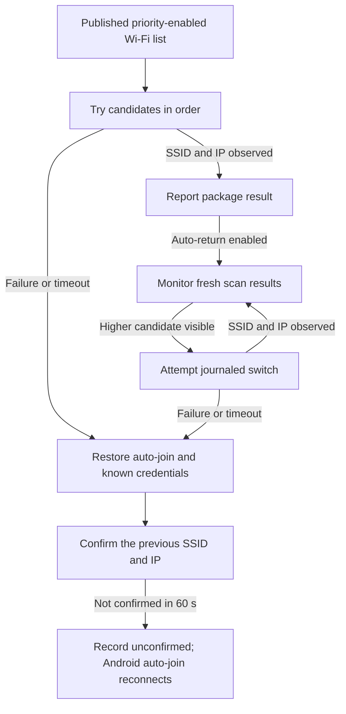

# Wi-Fi in configuration packages

Wi-Fi settings support PICO 4 Ultra Enterprise on Android 13 or later on the
managed LAN. See
[configuration packages](DEVELOPMENT.md#configuration-packages) for saving,
deployment, assignment, and delivery behavior.

## Operator workflow

Open **Manage Groups → Configuration Packages**, choose a package, then
expand **Network & connectivity**. Select **Manage** on **Wi-Fi networks**
and add Open or WPA2/WPA3 Personal networks. A blank password field
keeps the saved key for the same SSID and security. Choose **Save & deploy**.
The confirmation includes all assigned groups and members. Offline devices receive the latest revision when they connect.
The group **Settings** tab shows Wi-Fi readiness and the last result.

The list order defines priority: the first network is preferred, and a package
can contain up to four networks. This setting applies to every group using the
package. With the automatic-return option off, the client selects in priority
order during application and when disconnected. With it on, the client also
checks for higher-priority networks
while connected to a lower candidate, regardless of whether it was selected
manually. The first check runs within about 30 seconds, with later requests
about five minutes apart (each with a small random delay so headsets that start
together do not scan together); a fresh system scan can also trigger a switch
earlier. No
priority scan is needed while connected to the first candidate. A switch can
temporarily interrupt communication.
After an automatic-return attempt settles, the client waits about five minutes
before another automatic-return attempt, including when it moved to a higher
candidate successfully. Consecutive failed attempts, such as a visible preferred
network with a wrong password or a weak signal, double the wait up to 30
minutes; a success resets it. This also applies if someone selects a lower
candidate in the meantime. A changed Wi-Fi policy can be applied during this
wait. An app process restart clears it. When disconnected, the client waits eight
seconds plus up to three random seconds for a connection to return before
selecting in order. The ordered selection runs once per offline period; if it
fails, the client leaves reconnection to Android auto-join, which stays enabled
for every listed network, and selects in order again only after the headset has
been online. If Android joins a network while the client is still checking the
previous connection, the client keeps it. With a single listed network, the
client leaves reconnection to Android without starting priority monitoring.
Automatic return does not support hidden SSIDs; turn it off to use hidden
networks.

WPA2/WPA3 Personal prefers WPA3 when supported and allows WPA2 fallback.
Passwords contain 1–63 printable ASCII characters; passwords shorter than
eight characters can connect only with WPA3. Update the client APK before
deploying the Wi-Fi format. Settings and Wi-Fi journals written by development
builds of this feature are not supported; recreate them. Before updating a
client, let any in-progress Wi-Fi operation and package handoff finish or
recover.
The console shows the connected client's monitor status separately from the
last package-application result. **Applied** records a verified Wi-Fi profile.
During the same OS boot, a new revision with matching verified Wi-Fi settings
carries the result forward and keeps the connection and priority monitor.
Returning to an earlier package compares its settings with the most recent
completed attempt. If reassignment after **No package** does not start a new
attempt, the client resumes Wi-Fi management when Wi-Fi previously applied
and matches the saved profile. This also works across an OS reboot when
another setting needs Retry.

Automatic return depends on fresh Android scan results. Scan throttling,
sleep, permissions, and radio conditions can delay detection or make monitoring
degraded; no detection interval is guaranteed. A Wi-Fi IP on the selected
SSID is a local connection check, not proof that the MDM server is reachable.
When scan requests fail, the client also increases its request interval from
ten minutes up to 30 minutes; fresh passive scans may still trigger detection.

Managed Wi-Fi adds or updates the listed networks and enables their automatic
connection. Other saved networks remain on the device with auto-join disabled.
Clearing **Manage** and publishing leaves the device's existing networks and
auto-join settings in place. Removing the package assignment has the same
effect. The package keeps the unchecked setting's values for the editor.

## Provisioning and recovery

Managed Wi-Fi requires Device Owner and precise location allowed all the time
with Location enabled. Exact-alarm access is optional: the APK declares
`USE_EXACT_ALARM`, which Android 13 and later grant at install (verified on PUI
5.15.7), and **Settings** shows its status. Provision Device Owner
explicitly with `dpm set-device-owner`. PICO documents that while a Device
Owner app is installed, other apps cannot use TobService advanced APIs such as
silent install, shutdown and reboot, kill-app, OTA install and screen recording.
The documentation lists PICO 4E and Neo3 models; the effect on PICO 4 Ultra
Enterprise has not been verified, so check other enterprise apps on the target
headsets before provisioning. Foreground-service location by itself
did not preserve configured-network access after disconnection on the tested
PUI build. The Wi-Fi worker starts recovery after foreground location promotion.

Before mutation, the client records the saved network IDs, SSID and security
identities, auto-join flags, and any previous credentials known to MDM. It
waits up to two seconds for the current connection to become identifiable;
if a usable connection cannot be matched to one saved network, it fails before
changing Wi-Fi. The first mutation starts a fixed 60-second elapsed-time budget
with an in-process watchdog and, when access is granted, an exact alarm. The
alarm wakes a sleeping headset and restarts a stopped client at the deadline.
Without it, the watchdog still rolls back while the client runs, but a rollback
can wait until the headset wakes or the client restarts. Each candidate can use up to
12 seconds within that budget. The client must observe a fresh connection to a
candidate SSID with a Wi-Fi IP. This test can succeed on an isolated network
where the MDM server is unreachable. The report remains local until the client
can reconnect.

On failure, the client restores the captured auto-join flags and MDM-known
credentials. A failure to re-enable a previously eligible saved network is a
restore failure. Added candidates remain saved with auto-join disabled. **Unknown
overwritten passwords cannot be restored.** A restored configuration may still
fail to connect if its AP or credentials changed. Applying a policy may overwrite
the currently connected network even when its previous password is unknown to
MDM; in that case a failed switch may require the operator to re-enter the old
password. Reapplying a managed policy writes its credentials because Android
cannot read them back for comparison.

When a usable connection existed before the attempt, the client tries to
reconnect to it and confirms its SSID and usable IP. It waits up to 60 seconds
after restoring settings. If still unconfirmed, it records the operation as
unconfirmed and resumes normal priority monitoring. The restored settings
re-enable auto-join, so Android rejoins the network when it becomes available;
the client does not keep forcing it. The original package result remains
failed. If there was no usable
prior connection, no reconnection check is required. A new policy or explicit
management release can supersede a pending connection check after settings have
been restored. This also applies when a new request retries a previously failed
restore: once the settings are restored, it may supersede the old connection
check and start its own attempt. Waiting for the old SSID is not a restore API
failure. A delayed callback from that old check cannot settle the new operation.

Interrupted Wi-Fi work recovers from the private `wifi-settings.json` journal
before another Wi-Fi mutation. The package attempt records its scalar
readbacks and the Wi-Fi operation ID before starting the switch. It waits
for local recovery to settle and uses an exact terminal result to complete
the attempt. A missing or unmatched result keeps the attempt interrupted.
After a failed restoration, the client retries the restore automatically after
about 30 seconds, 2 minutes and 10 minutes. After that, Retry or a new managed
Wi-Fi revision attempts to complete that restoration before writing new
networks. If a later Wi-Fi operation, such as an automatic switch, replaced the
latest telemetry result, the journal still retains the exact package-operation
outcome separately. The device reserves one receipt with the operation ID
and revision before queueing the operation. Late recovery of an older request
leaves that receipt intact. A past success for the
same revision never makes a failed Reapply successful. If no exact outcome survives, the package remains
interrupted. Clearing Wi-Fi management can release a settled recovery journal
without changing device values.
An unreadable journal stays blocked. Content startup waits for interrupted
Wi-Fi recovery for at most 60 seconds. The current Wi-Fi journal preserves
recovery data and known credentials across process restarts. The client writes
Wi-Fi during the first application after an OS boot, on **Reapply settings**
or Retry, and when it applies changed Wi-Fi settings. A write enforces the
auto-join settings and verifies a fresh connection. During a same-boot update
with matching, previously verified Wi-Fi, the client carries the profile into
the new revision and retains the automatic-return backoff. An unchanged failed
Wi-Fi setting retains its failure result so the operator can Retry it.

When the device accepts a release (removing the package or clearing
**Manage**), it saves the release in the Wi-Fi journal before changing the
cached package. The release prevents new automatic switches and cancels a
prepared automatic switch before it changes Wi-Fi. An admitted package
operation or an automatic switch that already changed Wi-Fi can finish before
release takes effect. A pending release survives app restart and can end a
pending connection check once the settings have been restored.

The PICO auto-join API uses TobService's `allow_wifi_auto_join` message. Read
the actual `WifiConfiguration.allowAutojoin` flag. A partial Wi-Fi configuration
can overwrite a network's security settings.

## Supported inputs and credential storage

Policies accept 1–4 networks, unique by SSID and security. SSIDs must contain
1–32 UTF-8 bytes without control characters, quotes, or backslashes. WPA2/WPA3
Personal passwords contain 1–63 printable ASCII characters; use at least eight
characters to allow WPA2 fallback. Hidden networks are supported when automatic
return is off.

The server keeps plaintext Wi-Fi credentials in the private package
registry and backups. HTTP editor responses, device reports, and console logs
omit passwords. The policy sent to an eligible member includes the credentials
required to configure its networks.
