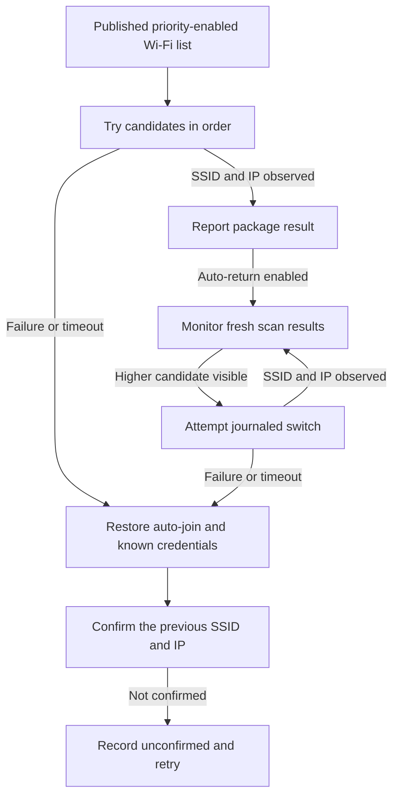

# Wi-Fi in configuration packages

Wi-Fi settings support PICO 4 Ultra Enterprise on the managed LAN. See
[configuration packages](DEVELOPMENT.md#configuration-packages) for draft,
publication, assignment, and delivery behavior.

## Operator workflow

Open **Manage Groups → Configuration Packages**, choose a package, then
expand **Network & connectivity**. Select **Manage** on **Wi-Fi networks**
and add Open or WPA2/WPA3 Personal networks. A blank password field
keeps the saved key for the same SSID and security. Choose **Save & deploy**.
The confirmation includes all assigned groups and members. Offline devices receive the latest revision when they connect.
The group **Settings** tab shows Wi-Fi readiness and the last result.

The list order defines priority: the first network is preferred, and a package
can contain up to four networks. This setting applies to every group using the
package. With the automatic-return option off, the client selects in priority
order during application and when disconnected. An existing connection is kept
after restart, and the client does not switch solely because a higher-priority
network reappears. With it on, the client checks for higher-priority networks
while connected to a lower candidate, regardless of whether it was selected
manually. The first check may run immediately, with later requests about five
minutes apart; a fresh system scan can also trigger a switch earlier. No
priority scan is needed while connected to the first candidate. A switch can
temporarily interrupt communication.
After an automatic-return attempt settles, the client waits about five minutes
before another automatic-return attempt, including when it moved to a higher
candidate successfully. This also applies if someone selects a lower candidate
in the meantime. A new package revision is not delayed by the previous wait;
an app process restart clears it. When disconnected, the client waits eight
seconds for a connection to return before selecting in order. Repeated failed
selections while disconnected are retried after five minutes, with the delay
increasing to a maximum of 30 minutes.
Automatic return does not support hidden SSIDs; turn it off to use hidden
networks.

WPA2/WPA3 Personal prefers WPA3 when supported and allows WPA2 fallback.
Passwords contain 1–63 printable ASCII characters; passwords shorter than
eight characters can connect only with WPA3. Update the client APK before
deploying the new Wi-Fi format. Existing development Wi-Fi settings use an
older format and must be recreated. A registry containing the old format cannot
load its configuration packages until those entries are removed; the saved
registry is retained. With the server stopped, back up the private registry and
remove the obsolete `wifi` and `wifiPriority` entries from each package's draft
and published `settings`. Give every modified draft or published snapshot a new
revision UUID; a revision must not identify two different settings. Restart the
server and recreate the Wi-Fi settings in the console. Other package settings
and group assignments can be kept. The registry
contains credentials; protect the backup accordingly. Before updating a client,
let any in-progress Wi-Fi operation and package handoff finish or recover.
The console shows the connected client's monitor status separately from the
last package-application result.

Automatic return depends on fresh Android scan results. Scan throttling,
sleep, permissions, and radio conditions can delay detection or make monitoring
degraded; no detection interval is guaranteed. A Wi-Fi IP on the selected
SSID is a local connection check, not proof that the MDM server is reachable.
When scan requests fail, the client also increases its request interval from
ten minutes up to 30 minutes; fresh passive scans may still trigger detection.

Managed Wi-Fi adds or updates the listed networks and enables their automatic
connection. Other saved networks remain on the device with auto-join disabled.
Clearing **Manage** and publishing leaves the device's existing networks and
auto-join settings in place. Removing the package assignment has the same
effect. The draft retains the unchecked setting's values.

## Provisioning and recovery

Managed Wi-Fi requires Device Owner, precise location allowed all the time with
Location enabled, and exact-alarm special access. Provision Device Owner
explicitly with `dpm set-device-owner`. Foreground-service location by itself
did not preserve configured-network access after disconnection on the tested
PUI build. The Wi-Fi worker starts recovery after foreground location promotion.

Before mutation, the client records the saved network IDs, SSID and security
identities, auto-join flags, and any previous credentials known to MDM. It
waits up to two seconds for the current connection to become identifiable;
if a usable connection cannot be matched to one saved network, it fails before
changing Wi-Fi. The first mutation starts a fixed 60-second elapsed-time budget
with an exact alarm and an in-process watchdog. Each candidate can use up to
12 seconds within that budget. The client must observe a fresh connection to a
candidate SSID with a Wi-Fi IP. This test can succeed on an isolated network
where the MDM server is unreachable. The report remains local until the client
can reconnect.

On failure, the client restores the captured auto-join flags and MDM-known
credentials. Added candidates remain saved with auto-join disabled. **Unknown
overwritten passwords cannot be restored.** A restored configuration may still
fail to connect if its AP or credentials changed. Applying a policy may overwrite
the currently connected network even when its previous password is unknown to
MDM; in that case a failed switch may require the operator to re-enter the old
password. Reapplying a managed policy writes its credentials because Android
cannot read them back for comparison.

When a usable connection existed before the attempt, the client tries to
reconnect to it and confirms its SSID and usable IP. It waits up to 60 seconds
after restoring settings. If still unconfirmed, it records that state and
retries the saved network about every five minutes. The original package result
remains failed even if a later connection check succeeds; the latest Wi-Fi
operation shows the updated recovery status separately. If there was no usable
prior connection, no reconnection check is required. A new policy or explicit
management release can supersede a pending connection check after settings have
been restored.

Interrupted Wi-Fi work recovers from the private `wifi-settings.json` journal
before another Wi-Fi mutation. The package attempt records its scalar
readbacks and the Wi-Fi operation ID before starting the switch. It waits
for local recovery to settle and uses an exact terminal result to complete
the attempt. A missing or unmatched result keeps the attempt interrupted.
After a failed restoration, Retry or a new managed Wi-Fi revision
attempts to complete that restoration before writing new networks. Clearing
Wi-Fi management can release a settled recovery journal without changing
device values.
An unreadable journal stays blocked. Content startup waits for interrupted
Wi-Fi recovery for at most 60 seconds. The current Wi-Fi journal preserves
recovery data and known credentials across process restarts. Completed state in
the earlier development format is discarded on upgrade; an unfinished or
unreadable old recovery journal must be resolved before updating. The client applies the assigned
published version after connecting in each boot. A failed or interrupted
version waits for Retry or a new publication.

The PICO auto-join API uses TobService's `allow_wifi_auto_join` message. Read
the actual `WifiConfiguration.allowAutojoin` flag. A partial Wi-Fi configuration
can overwrite a network's security settings.

## Supported inputs and credential storage

Policies accept 1–4 networks, unique by SSID and security. SSIDs must contain
1–32 UTF-8 bytes without control characters, quotes, or backslashes. WPA2/WPA3
Personal passwords contain 1–63 printable ASCII characters; use at least eight
characters to allow WPA2 fallback. Hidden networks are supported when automatic
return is off.

The server keeps plaintext Wi-Fi credentials in the private package
registry and backups. HTTP editor responses, device reports, and console logs
omit passwords. The policy sent to an eligible member includes the credentials
required to configure its networks.
